# SiterList

Plataforma pessoal e local-first para criar, personalizar e exportar tier lists de qualquer tipo de item — álbuns, jogos, filmes, personagens, comidas, lugares e mais. A foto já basta para adicionar um item; nome, detalhe, tier e nota são opcionais. Sem login, anúncios ou servidor de dados: as listas e as preferências ficam no armazenamento local do navegador, com até 5 MB, e as imagens enviadas ficam no IndexedDB.

A interface é monocromática, em preto, branco e cinzas, com tipografia Poppins. A cor entra pelo conteúdo: capas, tiers e personalização de cada lista. Como opção, o tema **Mel** veste a interface inteira de rosa pastel, com gatinhos e patinhas discretos.

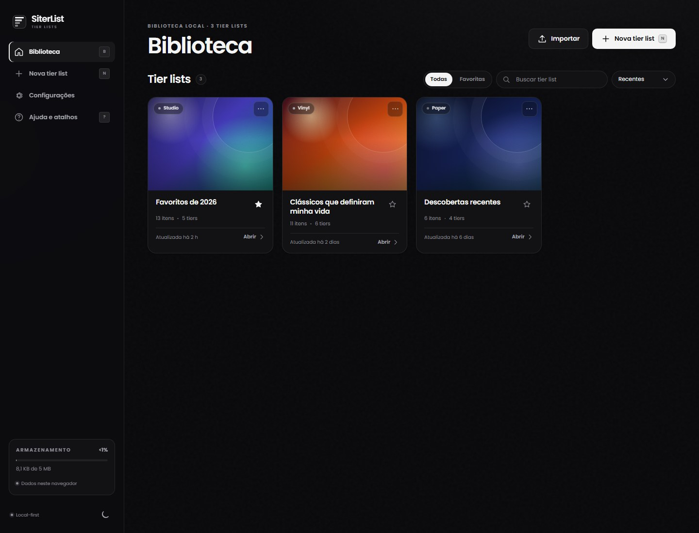

## Como abrir

O projeto precisa ser servido por HTTP para que `localStorage`, cookies e IndexedDB funcionem. **Não abra `index.html` diretamente pelo `file://`.**

No Windows:

1. Dê dois cliques em `serve.cmd`.
2. O navegador abre automaticamente em `http://localhost:4174`.
3. Para encerrar, pressione `Ctrl+C` na janela do terminal.

Ou, pelo PowerShell:

```powershell
.\serve.ps1
# outra porta, se necessário
.\serve.ps1 -Port 8080
```

O servidor é apenas um arquivo estático local. Nenhum dado sai do navegador.

## O que está pronto

- **Biblioteca** compacta, com busca, filtro de favoritas, ordenação, destaque de continuidade e cards com capa.
- **Criação** de tier list com nome, descrição, capa (gradientes autorais ou upload), tema, cor de destaque, quantidade de tiers e itens de exemplo.
- **Itens foto-first** — ao adicionar, o app pede só a foto. O nome é sugerido pelo arquivo internamente e pode ser ajustado depois; sem nome, o item fica como “Sem título”. Detalhe, tier e nota também são opcionais e ficam na edição.
- **Editor** com drag-and-drop entre tiers, campo de não ranqueados, busca interna, notas por item, adição e edição a qualquer momento.
- **Aparência** com Theme Studio (Studio, Vinyl, Neon, Paper e Mono), cor de destaque personalizada ou extraída da capa, três layouts de card, tamanhos, fundo e legendas.
- **Tiers** renomeáveis, recoloríveis, reordenáveis, removíveis e expansíveis até 12. Rótulos longos reduzem a fonte para caber no quadrado colorido sem repartir palavras, no editor e na exportação.
- **Histórico** com desfazer/refazer, autosave e status de armazenamento.
- **Exportação** em PNG ou WebP (1×, 2×, 3×), fundo do tema, claro ou transparente, além de copiar o ranking como texto.
- **Backup** em JSON com opção de mesclar ou substituir tudo, e importação validada.
- **Preferências** de tema claro/escuro/sistema, redução de movimento e estrutura padrão.
- **Tema Mel** ativável em Configurações: paleta rosa pastel, fundo de patinhas, gatinho decorativo, orelhas na marca e ícone de patinha no botão de tema. A escolha persiste entre sessões; o toggle do topo continua alternando claro/escuro e, ao sair do Mel, define o modo escuro.
- **Responsivo** para desktop, tablet e celular, com navegação inferior e tiers em rolagem horizontal no mobile.

### Telas

| Editor | Aparência |
| --- | --- |
| 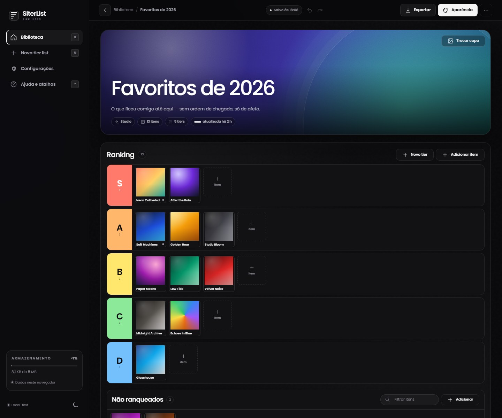 | 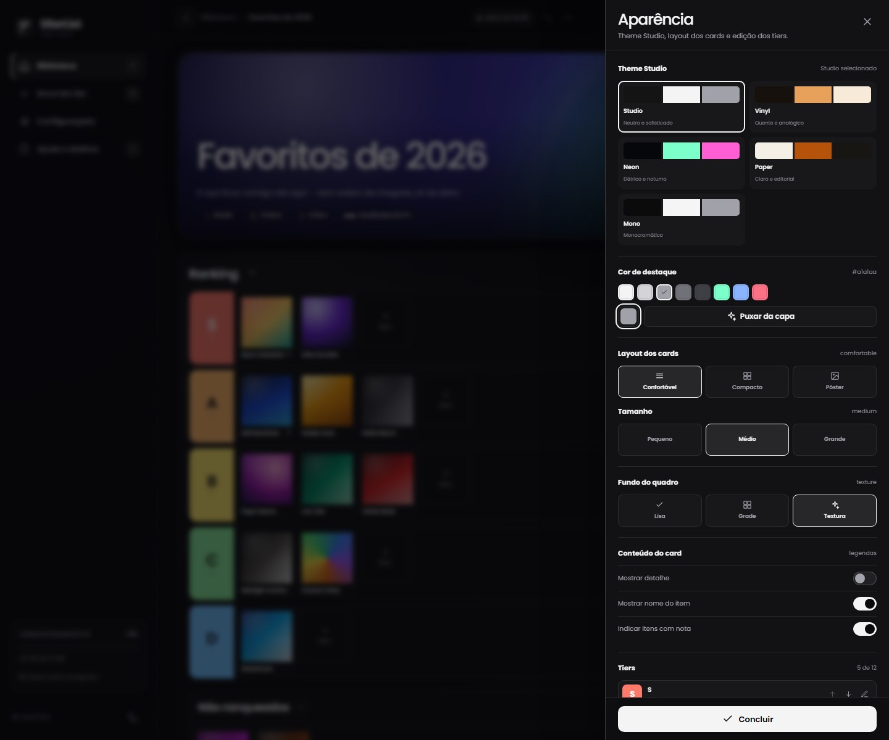 |

| Nova tier list | Exportação |
| --- | --- |
| 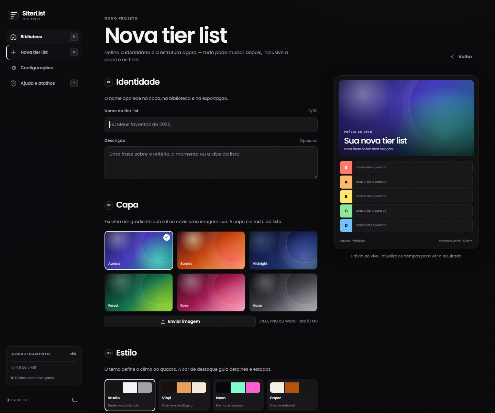 | 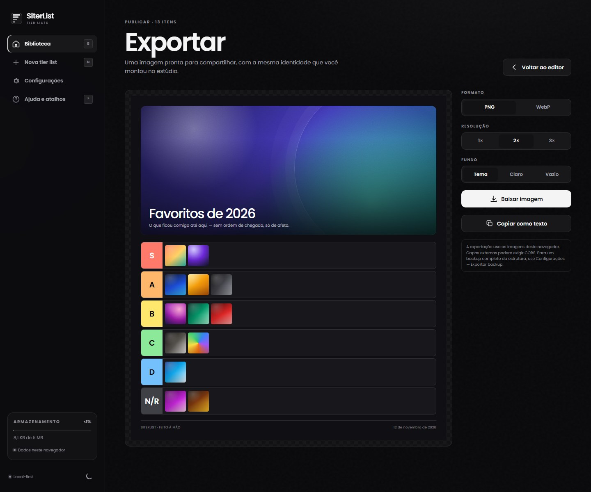 |

| Adicionar item (só foto) | Biblioteca no celular | Editor no celular |
| --- | --- | --- |
| 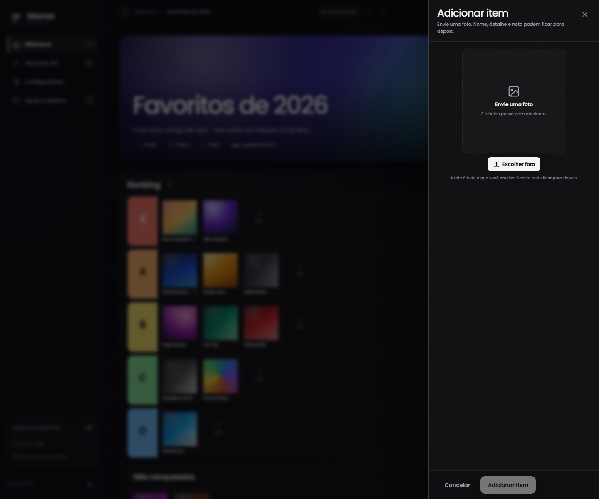 | 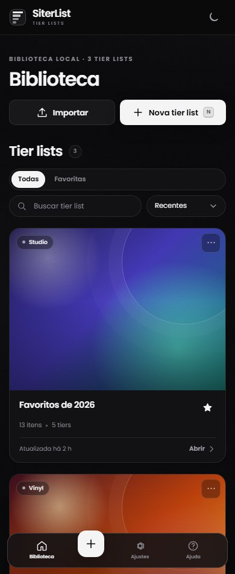 | 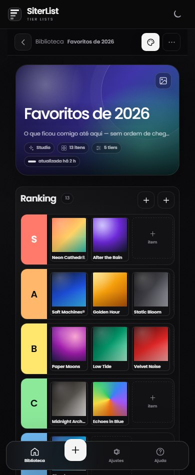 |

### Tema Mel

| Biblioteca | Editor | Configurações |
| --- | --- | --- |
| 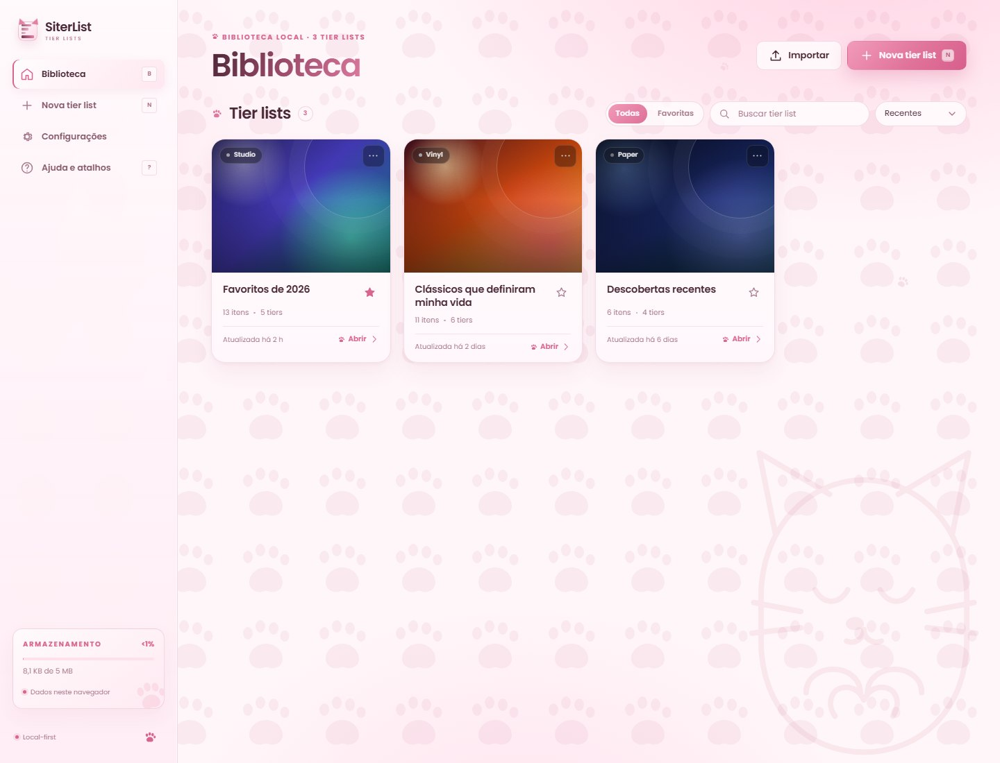 | 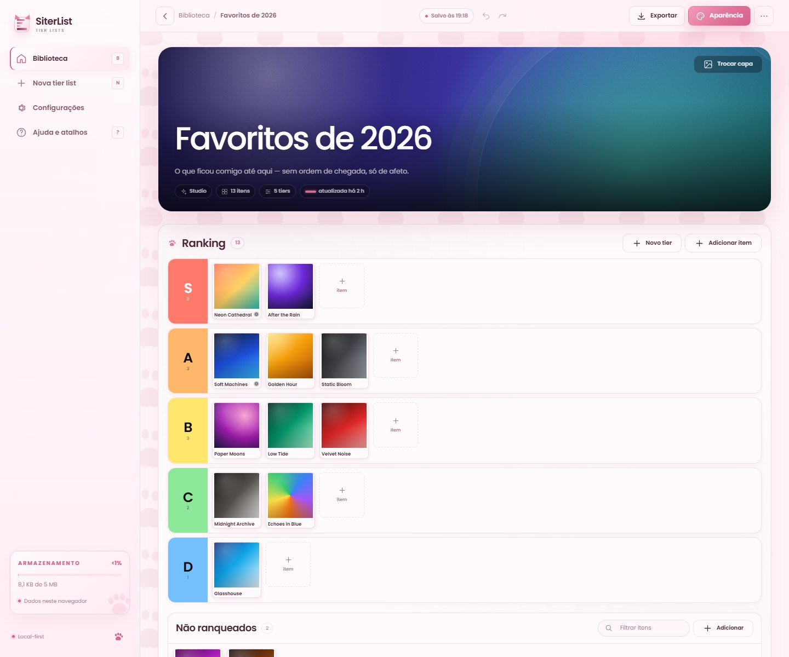 | 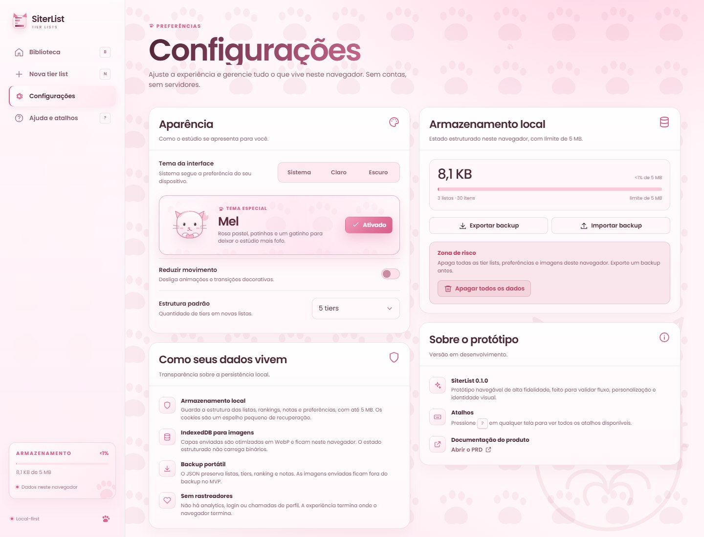 |

## Dados e privacidade

- **localStorage** (`tierlist-studio-backup-v1`) guarda a estrutura, o ranking, as notas e as preferências, com limite de **5 MB**.
- **Cookies** (`ts_0…n` + `ts_meta`) funcionam como espelho de recuperação para estados de até 32 KB, em blocos de aproximadamente 1,2 KB e validade de 400 dias. Acima disso, os cookies guardam apenas um ponteiro para o estado local.
- **IndexedDB** (`tierlist-studio-assets`) guarda as fotos enviadas, otimizadas em WebP.
- **Backup JSON** preserva listas, tiers, ranking e notas. As imagens enviadas não entram no arquivo no MVP.
- **Configurações → Apagar todos os dados** limpa o armazenamento local, os cookies e as imagens deste navegador.

O estado de demonstração ocupa cerca de 8,1 KB de 5 MB. O medidor aparece na barra lateral e em Configurações.

## Atalhos

| Tecla | Ação |
| --- | --- |
| `N` | Nova tier list |
| `B` | Biblioteca |
| `?` | Ajuda e atalhos |
| `/` | Buscar na biblioteca ou filtrar não ranqueados |
| `A` | Abrir Aparência no editor |
| `E` | Exportar no editor |
| `Ctrl+Z` / `Ctrl+Shift+Z` | Desfazer / refazer |
| `Esc` | Fechar painéis e modais |

## Estrutura

```
TierList/
├─ index.html          shell da SPA, marca, favicon e sprite de ícones
├─ styles.css          design system "Editorial Monochrome" + responsivo
├─ app.js              rotas, estado, editor, persistência e exportação
├─ fonts/
│  └─ poppins-*.woff2  Poppins 400, 500, 600 e 700 vendorizada
├─ serve.ps1           servidor estático local
├─ serve.cmd           atalho para abrir o servidor no Windows
├─ vendor/
│  └─ html2canvas.min.js
├─ docs/
│  ├─ PRD.md           documento de produto completo
│  └─ screens/         capturas das telas
└─ README.md
```

## Limitações do protótipo

- Sem login, backend, sincronização entre dispositivos ou colaboração — por decisão de MVP.
- Imagens ficam restritas ao navegador onde foram enviadas e não viajam no backup JSON.
- Capas externas usadas em exportações podem esbarrar em CORS.
- O drag-and-drop usa a API nativa do navegador; no celular, prefira mover o item pelo seletor de tier no painel de detalhes.
- O estado fica restrito ao navegador onde foi criado. O espelho em cookies viaja em cada requisição, mas só existe para estados de até 32 KB; estados maiores ficam apenas no `localStorage`. Use o medidor de 5 MB e exporte backups.
- O PRD descreve o produto completo; este repositório implementa o protótipo navegável de alta fidelidade.

## Documentação

- [PRD — SiterList](docs/PRD.md)
